# claudeis

Your subagents as little Claudes in a pane: a mod for [Claude Code](https://claude.com/claude-code).



Every subagent gets a figure. It bobs while it works and shows the tool it is on. When it finishes it shows its result for two minutes, then falls asleep again. Under each figure you see the model, the tool calls, the tokens and the time. A history lists the session's runs.

Your own agent types (the ones in `~/.claude/agents` or a project's `.claude/agents`) live in the pane and sleep until they are called. Built-in agents such as Explore, and agents from plugins, drop by while they work.

## Install

In a Claude Code session in the terminal, type:

```
/plugin install claudeis --marketplace Noritem/claudeis
```

Answer `y` to add the marketplace, then press Enter for the user scope, so the mod runs in every session.

The pane opens by itself when the first subagent of a session starts. `/claudeis` opens it at any time. On a narrow terminal, a pane that opens by itself waits until there is room for it; `/claudeis` always opens it.

## Settings

Change these in `/config` under claudeis:

| Setting | Default | What it does |
| --- | --- | --- |
| `language` | `en` | The pane's language: `en` or `de` |
| `autoOpen` | `true` | Open the pane when the first subagent of a session starts |
| `snapshotTool` | `false` | Give the model a tool that reads the pane as text. This is for working on the mod; the tool's description is sent with every request |

## What you see

- **Colors** follow the model an agent actually ran on: Fable purple, Opus orange, Sonnet blue, Haiku green. Before one of your agents has ever run, its name decides the color, so an agent called `haiku-scout` starts out green.
- **tok** counts the input, cache-write and output tokens of a run.
- **cache reads** are counted separately in the header. A subagent reads its cached context again on every request, so these add up quickly, but each one costs about a tenth of a fresh input token.
- Up to eight of your own agent types stand in the pane. If you have more, the others appear only while they work.

## Developing

```
git clone https://github.com/Noritem/claudeis
claude --plugin-dir ./claudeis
```

- `hooks/register.tsx`: the events the mod listens to, and the pane.
- `hooks/crew.ts`: what the pane shows, as plain functions with no engine. The pane, the snapshot tool and the preview image all draw from it.
- `types/index.d.ts`: the state the mod keeps for the session.

Check your changes with `claude plugin validate .` and `claude plugin test .`. Type checking (`tsc -p .`) needs the types Claude Code writes to `.claude-plugin/types/` the first time it loads the mod. `node scripts/preview.mjs` draws `docs/preview.svg` again (Node 23.6 or later).

Built on Claude Code 2.1.296.

## License

MIT
